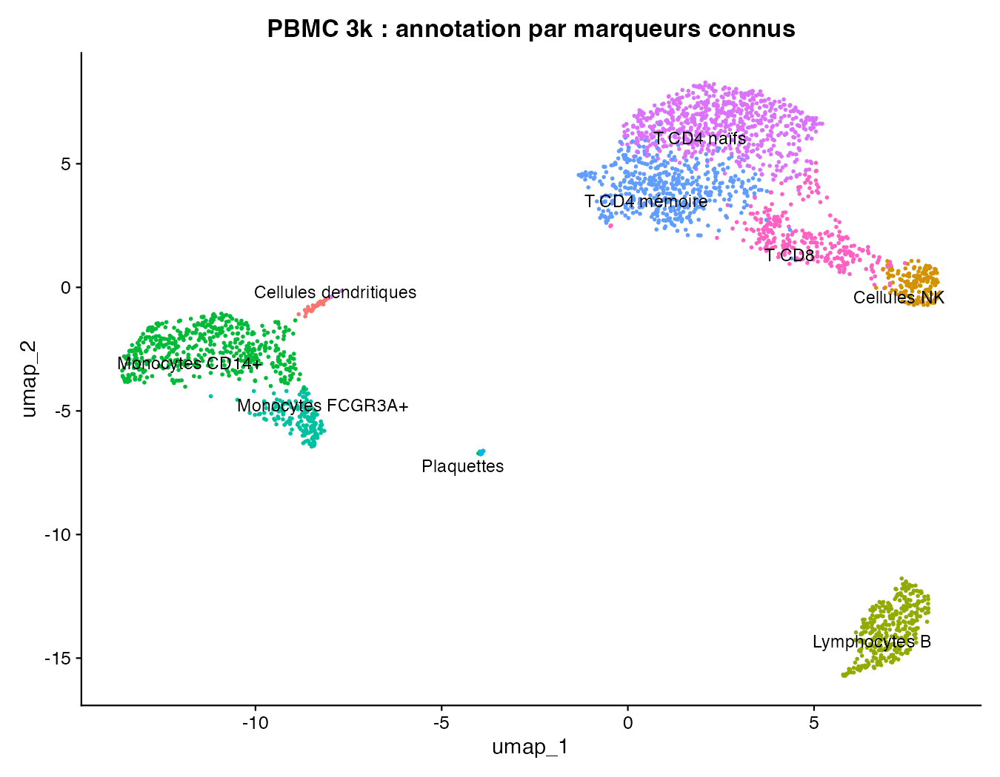
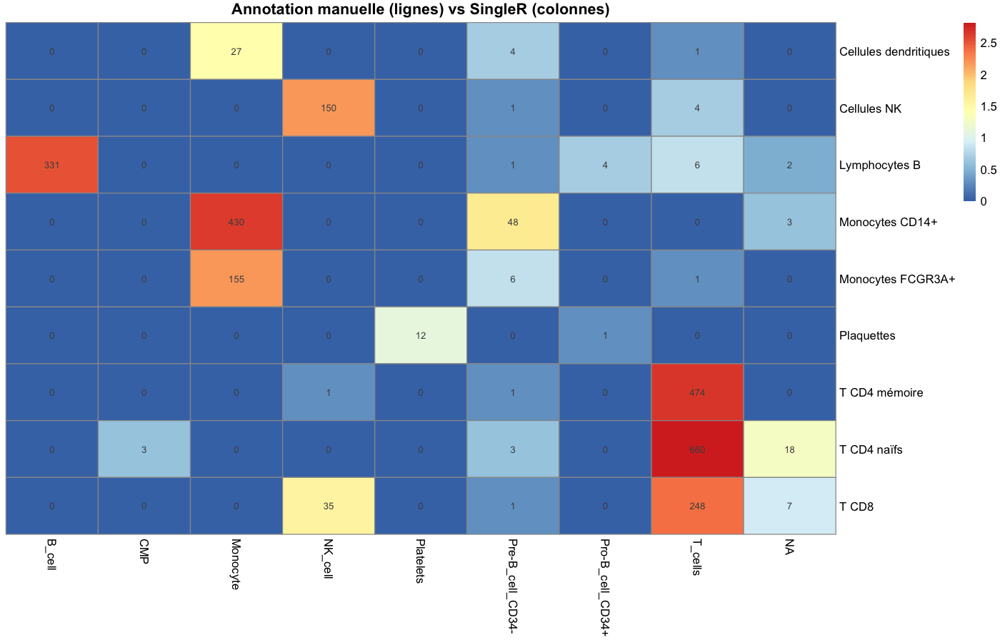

# Analyse single-cell RNA-seq de PBMC humaines avec Seurat

Pipeline reproductible d'analyse scRNA-seq sur le jeu de données public **PBMC 3k** (10x Genomics) : contrôle qualité, normalisation, réduction de dimension, clustering, UMAP, gènes marqueurs et annotation des types cellulaires, validée par annotation automatique (SingleR).

## Lancer l'analyse

Analyse réalisée sous macOS avec **R 4.5.1, Seurat 6.0.0 et SingleR** (versions complètes dans `results/sessionInfo.txt`).

```r
install.packages(c("Seurat", "dplyr", "ggplot2", "patchwork", "readr", "tidyr", "pheatmap", "BiocManager"))
BiocManager::install(c("SingleR", "celldex", "SingleCellExperiment"))
```

```bash
bash scripts/00_telecharger_donnees.sh
Rscript scripts/01_controle_qualite.R
Rscript scripts/02_normalisation_clustering.R
Rscript scripts/03_marqueurs_annotation.R
Rscript scripts/04_annotation_automatique_singler.R
```

Un environnement conda est aussi fourni (`environment.yml`, puis `bash scripts/run_all.sh`). Sous macOS, son installation échoue sur le package Bioconductor `GenomeInfoDbData` ; l'installation via CRAN/Bioconductor ci-dessus est alors recommandée.

## Structure

```
projet_singlecell_pbmc/
├── README.md                 ce fichier
├── environment.yml           environnement conda (R, Seurat, SingleR)
├── scripts/
│   ├── 00_telecharger_donnees.sh
│   ├── 01_controle_qualite.R
│   ├── 02_normalisation_clustering.R
│   ├── 03_marqueurs_annotation.R
│   ├── 04_annotation_automatique_singler.R
│   └── run_all.sh
├── data/                     données téléchargées (non versionnées)
└── results/                  figures, tables, objets intermédiaires
```

## Résultats

### Contrôle qualité et clustering

- **2 638 cellules** conservées sur 2 700 après filtrage (200 à 2 500 gènes détectés, moins de 5 % de lectures mitochondriales).
- 2 000 gènes variables, ACP réduite à **10 composantes** (coude de l'elbow plot). Les premières composantes ont un sens biologique : PC1 sépare cellules myéloïdes (CST3, LYZ) et lymphocytes (IL7R, LTB), PC2 sépare cellules cytotoxiques (NKG7, GZMB) et lymphocytes B (CD79A, MS4A1), PC3 isole les plaquettes (PPBP, PF4).
- **9 clusters** (algorithme de Louvain, résolution 0.5).

### Annotation des types cellulaires

Chaque cluster est annoté par un score de marqueurs connus (expression moyenne centrée-réduite entre clusters), puis vérifié avec ses gènes marqueurs trouvés sans a priori (test de Wilcoxon).

| Cluster | Type cellulaire | Marqueurs principaux | Cellules | % |
|---|---|---|---|---|
| 0 | T CD4 naïfs | CCR7, LEF1, MAL | 684 | 25,9 |
| 1 | Monocytes CD14+ | S100A8, S100A9, CD14 | 481 | 18,2 |
| 2 | T CD4 mémoire | AQP3, CD40LG, TRAT1 | 476 | 18,0 |
| 3 | Lymphocytes B | CD79A, TCL1A, VPREB3 | 344 | 13,0 |
| 4 | T CD8 | CD8A, GZMK, CCL5 | 291 | 11,0 |
| 5 | Monocytes FCGR3A+ | CDKN1C, MS4A4A, HES4 | 162 | 6,1 |
| 6 | Cellules NK | GNLY, GZMB, SPON2 | 155 | 5,9 |
| 7 | Cellules dendritiques | FCER1A, CLEC10A, SERPINF1 | 32 | 1,2 |
| 8 | Plaquettes | ITGA2B, GP9 | 13 | 0,5 |

**Correction manuelle.** Le score seul classait les deux clusters CD4 en « naïfs » : IL7R est commun aux deux signatures, et S100A4 (marqueur mémoire) est surtout exprimé par les cellules myéloïdes et NK. Le cluster 2 a été réannoté **T CD4 mémoire** au vu de ses marqueurs (AQP3, CD40LG, CCR7 plus faible que dans le cluster 0). La correction est faite dans le script, sur le critère CCR7 moins S100A4, et les deux annotations (score et finale) sont conservées dans `results/03_annotation_par_cluster.csv`.



### Validation par SingleR (Human Primary Cell Atlas)

- **93 % des cellules** (2 460 / 2 638) reçoivent de SingleR un type compatible avec l'annotation manuelle ; 95 % si l'on exclut les 30 cellules non annotées par SingleR et les cellules dendritiques, sans équivalent retenu par SingleR ici.
- Concordance quasi parfaite pour les lymphocytes B (331/344), les NK (150/155), les plaquettes (12/13) et les T CD4 (1 134/1 160 annotés « T_cells »).

Désaccords et interprétation :

- **Granularité** : la référence ne distingue pas T CD4 naïfs, T CD4 mémoire et T CD8 (un seul label « T_cells »). L'annotation par marqueurs est plus fine.
- **T CD8 / NK** : 35 T CD8 (12 %) sont classés NK. Ce sont probablement des T CD8 effecteurs cytotoxiques (GZMH, GZMK, NKG7), dont le profil est proche des NK.
- **Cellules dendritiques** : 27 des 32 sont classées « Monocyte ». Ce type, rare et proche des monocytes, n'est pas résolu par SingleR sur ce jeu de données.
- **« Pre-B_cell_CD34- »** (64 cellules, dont 48 monocytes CD14+) : un artefact de la référence, attendu ; il n'y a pas de précurseurs B dans du sang adulte sain.
- **30 cellules non annotées** par SingleR (score pas assez net), surtout des T CD4 naïfs (18) et des T CD8 (7).



## Données

PBMC 3k, 10x Genomics : <https://cf.10xgenomics.com/samples/cell/pbmc3k/pbmc3k_filtered_gene_bc_matrices.tar.gz>

## Références

- Hao Y. et al. (2024). Dictionary learning for integrative, multimodal and scalable single-cell analysis. *Nature Biotechnology* (Seurat v5).
- Aran D. et al. (2019). Reference-based analysis of lung single-cell sequencing reveals a transitional profibrotic macrophage. *Nature Immunology* (SingleR).
